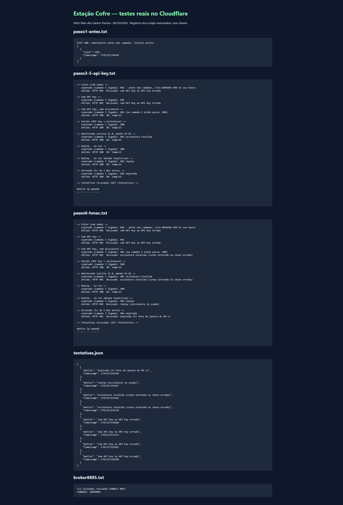
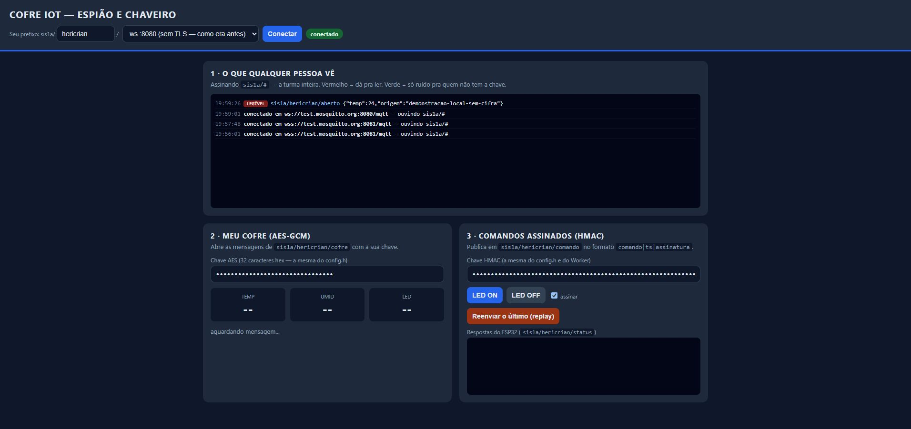
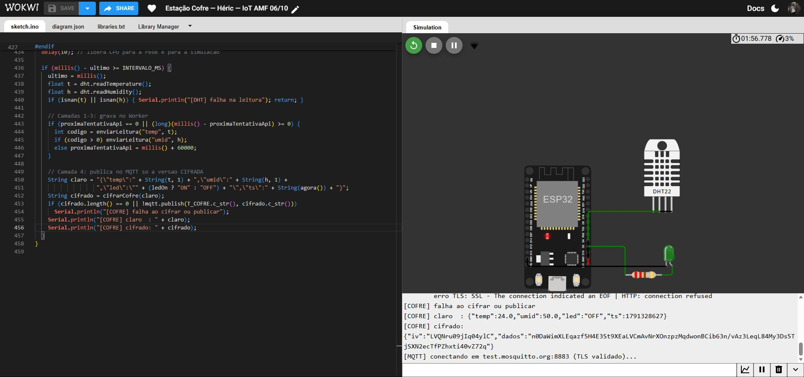

# Entrega — Estação Cofre

**Aluno:** Héric Rían dos Santos Pereira
**Turma:** AMF 2026-02
**Prefixo MQTT:** `sis1a/hericrian/`
**Worker publicado:** https://iot-cofre-heric.hericrianamf.workers.dev

**Wokwi:** https://wokwi.com/projects/477173835312859137

**Repositório independente:** https://github.com/hericrian/IoT-Estacao-Cofre-AMF-2026-02

## Implementação

Base: branch `06_10` do repositório do professor. O firmware usa CA no HTTPS e MQTT, API key e HMAC-SHA256 no POST, AES-128-GCM nas leituras MQTT e assinatura nos comandos de LED. O Worker valida assinatura sobre o corpo cru, janela de 60 segundos e unicidade da assinatura no D1. As consultas usam parâmetros vinculados. O Worker anterior foi preservado; esta atividade tem uma implantação separada, com tabelas auxiliares no D1 existente.

Acrescentei `.gitignore`, pois ele não existia na branch apesar de ser mencionado nas instruções. Corrigi validação do Worker para recusar null, strings e booleanos como leitura e rejeitar JSON que não seja objeto. No ESP32, acrescentei verificações de alocação e retorno da criptografia, terminação explícita do buffer Base64 e aviso de falha na publicação. Os certificados públicos foram gerados para o domínio acima e para o Mosquitto. As chaves locais foram geradas aleatoriamente e ficam somente em `config.h`, ignorado pelo Git.

## Evidências executadas em 06/10/2026

`npm test`: **6 testes aprovados, 0 falhas**. Código em `tests/seguranca.test.js`; execução local do Worker com substituto do binding D1, sem acesso à nuvem.

| Verificação local | Resultado |
|---|---|
| API key ausente / correta | 401 / 200 |
| Corpo adulterado / assinatura ausente | 401; nenhuma leitura gravada |
| Duas requisições iguais simultâneas | 200 e 401; uma leitura gravada |
| Timestamp antigo / futuro fora da janela | 401 |
| null, string, booleano, 999, sensor desconhecido, JSON inválido | 400; nenhuma leitura gravada |
| AES-GCM com chave correta | Decifra os bytes originais |
| AES-GCM com chave errada / ciphertext adulterado | Recusa a decifragem |

O teste de AES usa WebCrypto e valida o algoritmo; não comprova a integração com o ESP32. O substituto de D1 não comprova o comportamento de uma implantação real.

## Testes reais na nuvem e no ESP32

O Worker foi publicado e o schema aplicado ao D1 remoto. Os registros em `evidencias/` vêm de execuções reais em 06/10/2026:

| Etapa | Resultado real | Registro |
|---|---|---|
| Antes das proteções, no Worker novo de laboratório | POST sem credenciais gravou 999; consulta confirmou | `passo1-antes.txt` |
| Apenas API key | Sem chave: 401; com chave: adulteração e replay ainda aceitos | `passo3-5-api-key.txt` |
| API key + HMAC + anti-replay | 7 verificações remotas aprovadas; requisição válida 200, adulterada/replay/horário inválido 401, JSON null 400 | `testes-remotos.json`, `passo6-hmac.txt` |
| MQTT sem cifra | Mensagem própria de laboratório apareceu legível no painel | `passo1-mqtt-legivel.jpg` |
| MQTT 8885 com CA | TLS estabelecido; login público recusado, CONNACK 5 | `broker8885.txt`, `passo4-broker8885.jpg` |
| Cliente WebSocket do painel | Publicação e assinatura reais no broker devolveram os mesmos bytes UTF-8 | `teste-transporte-mqtt.json` |
| Firmware Wokwi | Compilou, conectou Wi-Fi/NTP, leu DHT22 (24 °C / 50%) e gerou AES-GCM | `wokwi-leitura-cifra-falha-rede.jpg`, `wokwi-leitura-cifra-serial.txt` |
| Cifra produzida pelo ESP32 | Ciphertext capturado no Serial abriu com a chave correta e recusou duas chaves diferentes | `cifra-real-esp32.json` |

O valor 999 e o payload MQTT aberto são dados deliberados de laboratório no próprio projeto. Não representam medições reais de uma sala nem mensagens de colegas. O print do Worker mostra uma página que apresenta os logs reais dos scripts, não uma captura de terminal.

## Limitações verificadas e etapas ainda pendentes

Não foi possível confirmar o fluxo completo ESP32 → HTTPS/MQTT → painel. O HTTPS no Wokwi encerrou com EOF (`HTTP -1`); MQTT 8883 teve timeout (`rc=-4`). O broker 8885 recusou `rw/readwrite` com CONNACK 5. Tentativas posteriores de conexão fora do Wokwi também ficaram sem resposta. Nenhuma dessas falhas foi apresentada como sucesso.

O firmware tem fallback de 8885 para 8883, com CA validada. A configuração pública do Wokwi inicia em 8883. O painel oferece uma ponte local em `ws://127.0.0.1:8789/mqtt`: o trecho no computador usa loopback e o servidor estabelece TLS com validação da CA até o broker. Essa alternativa contorna a falha do WSS direto observada no Edge; não comprova a conexão MQTT do ESP32. As diferenças em relação à porta 8885 exigida no enunciado estão registradas aqui.

Ainda faltam evidências práticas de CA errada no ESP32, cofre recebido diretamente do ESP32 no painel e comandos de LED assinados/sem assinatura/repetidos/com chave diferente. O algoritmo AES foi confirmado com bytes reais do firmware via Serial; esse teste não substitui o transporte MQTT. A atividade prática tem essas pendências de integração, apesar de código, respostas e testes de segurança do Worker estarem concluídos.

O [broker público documenta possíveis indisponibilidades de TLS/WebSockets](https://test.mosquitto.org/). A [documentação de rede do Wokwi](https://docs.wokwi.com/guides/esp32-wifi) descreve o gateway usado pela simulação.

## Respostas

1. **CA errada:** falhar impede confiar em um servidor cuja identidade não foi validada. `setInsecure()` desativa a verificação do certificado e permitiria a conexão com um impostor se o restante do handshake funcionasse.

2. **TLS e AES:** TLS cifra cada conexão até o broker. O broker recebe a mensagem em claro e a entrega aos assinantes autorizados pelo broker público. AES-GCM cifra o conteúdo antes da publicação; somente a ponta que possui a chave pode decifrar e validar a tag.

3. **API key e HMAC:** uma requisição capturada com API key revela a chave e permite criar outras requisições até a revogação. Capturar HMAC revela uma assinatura vinculada àqueles bytes, não o segredo. Ainda é possível reenviar a requisição original, razão para usar timestamp e controle de replay. Nesta atividade as duas camadas são combinadas.

4. **Timestamp fora da assinatura:** um atacante poderia renovar o horário de uma mensagem capturada sem invalidar o HMAC, burlando a expiração. Assiná-lo vincula conteúdo e tempo. O registro de uso único continua necessário dentro da janela válida.

5. **Texto cru:** espaços, ordem das propriedades e representação dos números podem mudar quando o JSON é reconstruído. HMAC deve verificar exatamente os bytes enviados; a interpretação e validação do JSON vêm depois.

6. **Leituras públicas:** podem ser aceitáveis para dados didáticos deliberadamente públicos. No monitoramento de sala, horários de movimento e presença revelam hábitos e ocupação; no projeto final eu protegeria essas consultas com autenticação e autorização e reduziria os dados expostos.

7. **Mil dispositivos:** provisionaria identidade e chave únicas por dispositivo, com armazenamento protegido. Um serviço autenticado distribuiria chaves apenas aos usuários autorizados, usando TLS e mecanismos de criptografia assimétrica para estabelecimento ou encapsulamento de chaves. Preveria revogação e rotação, sem chave global embutida na página.

8. **Projeto final:** considerando o monitoramento de sala já desenvolvido, um atacante poderia falsificar presença/luminosidade e, com um atuador futuro, ligar ou desligar iluminação indevidamente. Levaria TLS com CA validada, autenticação e HMAC com anti-replay para escrita e comandos, proteção de consultas de presença e segredos fora do Git. O impacto de relé/bomba depende do atuador escolhido; não foi presumido hardware que ainda não existe.

## Retomar os testes de integração

1. Executar `npm ci` e `node scripts/servir-pagina.mjs`; abrir http://127.0.0.1:8789/cofre.html e selecionar a ponte local se WSS direto não conectar.
2. Iniciar o Wokwi e fornecer as três chaves locais pelo Serial no formato `API_KEY|CHAVE_HMAC|CHAVE_AES_HEX`. Deixar a simulação ativa para reduzir o atraso; as chaves não devem aparecer em prints nem ser salvas no projeto público.
3. Confirmar primeiro HTTPS 200 e MQTT conectado no Serial. Digitar `TESTE_CA` para executar a tentativa com CA errada e restaurar a correta automaticamente.
4. No painel, inserir as chaves corretas nos campos mascarados; comparar duas chaves AES diferentes e os comandos assinados, não assinados, replay e HMAC diferente. Capturar cada resposta real e o LED.
5. O Worker já está publicado com Secrets e `EXIGIR_ASSINATURA=sim`. `node scripts/testar-worker.mjs` repete as 7 verificações reais na nuvem; `node scripts/verificar-cifra-serial.mjs` repete a verificação do ciphertext já capturado.
6. Para outra placa/domínio, configurar `config.h` local e regenerar os certificados com PowerShell 7: `pwsh -File scripts/gerar_certificados.ps1 -Worker SEU-DOMINIO`.
